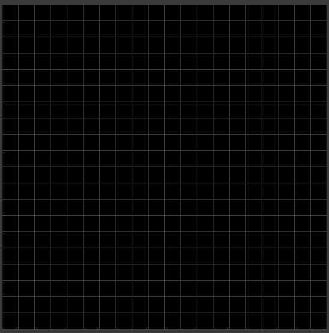
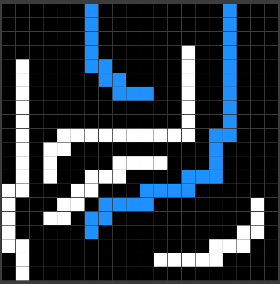
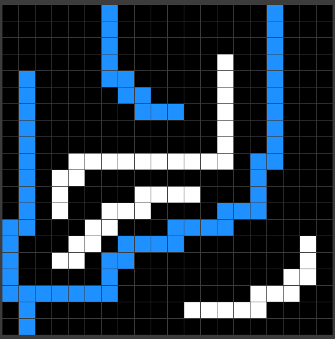

# Percolation Lab

In this project, you will demonstrate your knowledge of the Union-Find data structure by (1) implementing and assessing the efficiency of three versions of UF and (2) utilizing the most efficient in a monte carlo simmulation.

## Lab Description

As noted above, this lab will involve comparing three separate UF algorithms and then implementing one of them to simulate the solution to a problem.

### UF Implementations

To begin this lab you will need to implement the `UnionFind` interface in three different classes:

- [`QuickFind.java`](./QuickFind.java)
- [`QuickUnion.java`](./QuickUnion.java)
- [`WeightedQuickUnion.java`](./WeightedQuickUnion.java)

The interface has four methods:

- `void union(int a, int b)`: connects two nodes, a and b.
- `int find(int a)`: finds the id of the connected component of a.
- `boolean connected(int a, int b)`: checks if a and be are connected.
- `int count()`: returns the total number of distinct connected components in the UF system.

You will notice that a body for the method `connected(a, b)` has already been provided in `UnionFind.java`:

```java
public default boolean connected(int a, int b) {
    return this.find(a) == this.find(b);
}
```

This is because the `connected` method is rarely different in any implementation. It Will be automatically inherited by any implementing class. Otherwise, you have basically done most of the work for these three classes for homework.

#### Timing

After you have correctly implemented the UF classes, test the runtime of each class. To help with this, I have provided you a little helper class that constructs three UF objects (one for each algorithm) of size `n` and performs `n` random union and find operations, printing out the time taken by each test. Compile and run `Test.java` (make sure to specify the value of `n` using a command line argument: `java Test 100` for example).

Run a couple of these tests, then answer the following questions:

1. Which is the most efficient for small to medium values of `n`? Does that change for larger `n` values?

2. If you double the value of `n` (starting at a medium or large value -- don't choose 5), what happens to the runtime of each algorith? Does it double? More than double? Try starting with a number of different `n` values. Does this confirm or challenge the theoretical runtimes of each?

3. At what value of `n` do `QuickUnion` and `QuickFind` become too slow? What is the runtime of `WeightedQuickUnion` when this happens?

Place the answers to these questions as a text or markdown file in your repository.

## Percolation

One application of the dynamic connectivity problem is checking if a material "percolates." We will simulate this by assuming we have some solid material arranged in a square lattice:



But, we can poke holes in that grid. We want to know if water can flow from the top of the grid to the bottom through the holes that we poke (water can flow from an open square to another open square below, above, left, or right of it):



And, if we poke enough holes, the system will "percolate:" water can flow across the lattice from somewhere up top, and out somewhere on the bottom.



### Modeling Percolation

You will model the percolation system by filling in the class `Percolation` located in [`Percolation.java`](./Percolation.java). The api is as follows:

```java
public class Percolation {
    /* Creates an n x n percolation grid, with all sites blocked*/
    public Percolation(int n)

    /* opens the size (row, col) if it s not open already*/
    public void open(int row, int col)

    /* is the site (row, col) already open*/
    public boolean isOpen(int row, int col)

    /* is the site (row, col) full of water? */
    public boolean isFull(int row, int col)

    /* how many sites are open? */
    public int numberOfOpenSites()

    /* does the system percolate */
    public boolean percolates()
}
```

In short, `Percolation` represents an $n \times n$ grid with all of the grid sites initially closed/blocked. We can open any site using the `open()` method above. We imagine that there is water sitting above the lattice. Therefore a site has water (is full) if and only iff it is either an open site on the top row or _connected to_ an open site on the top row.

We say that two sites are connected if there is a path of open sites between them moving only up, down, left and right (water cannot flow diagonally here).

The system _percolates_ if any open site on the bottom row has water in it.

#### Using Union Find

Hopefully, you've already smelled the presence of the Union Find data structure. Keeping track of all the connections in the grid is possible by representing the $n \times n$ grid with a UF system with $n^2 + 2$ nodes, one node for each square...plus two more special nodes.

The non-special nodes are straightforward: nodes are connected if and only if water can flow between them. Each time a node is opened, make sure to connect it to all and _only_ those adjacent nodes which were open previously (a closed node is never connected to anything).

The special nodes are for the _top_ and _bottom_ of the system. As we open nodes, we connect this extra top node to every open site on the top row. Thus any node in the UF is full of water if it is connected to this top node. Similarly, we connect the extra bottom node to any site opened on the bottom row. Therefore, the system percolates if and only if the top node and bottom node are connected!

#### Grid System

The percolation lattice is a grid, and our API requires a row and column to identify a single site. Row 0, Column 0 describes the site in the top left corner and Row $n-1$ Column $n-1$ picks out the bottom right.

 On the other hand, the nodes in our UF system are numbered sequentially, so the grid cells end up needing two separate numbering systems. So, how do you number them.

I suggest numbering them in order starting in the top left corner and counting as you would read the lines of a book: move along the row and then move down to the next one. Then, we can easily calculate the value of the nodes in each of the four directions.

But, be careful! The node to the right is alwasy one greater than the current node, but one greater than the current node is not always the node to the right! If you're at the end of a row, there is no node to the right. A similar case is occurs for all four directions.

### Monte Carlo Simulation

Here is a scientific question: how pourous does a lattice need to be in order to percolate on average? In other words, if we opened sites in the lattice randomly, how many would we expect to open before percolation occurs?

The answer to that question is, mathematically, unknown. But, we _can_ get an experimental answer (CS is an empirical science, you know) by using a monte carlo simulation.

Basically, the idea is to just try randomly poking holes in some latices until the thing percolates, calculating what percentage had to be opened and then repeating the process a whole bunch of times. The name Monte Carlo, by the way, comes from the location of a giant casino in the tiny city stat of Monaco: we're basically using a casino technique (randomness) to solve a problem we otherwise couldn't.

#### Percolation Stats

To conduct the monte carlo simulation, you will need to fill in the class `PercolationStat`. Here is the API:

```java
public class PercolationStats {

    /* perform a given number of trials on an n-by-n grid*/
    public PercolationStats(int n, int trials)

    /* sample mean of the percolation threshold */
    public double mean()

    /* the sample standard deviation of percolation threshold */
    public double stddev()

    /* low endpoint of the 95% confidence interval */
    public double confidenceLo()

    /* high endpoint of 95% confidence interval */
    public double confidenceHi()

    /* test client */
    public static void main(String[] args)
}
```

The class in [`Stats.java`](./Stats.java) has lots of statistical helper methods for most of this. The only thing that you need to do some real math on is the confidence interval which is given by:

$$ \left[\overline{x} - \frac{1.96s}{\sqrt{T}} ,\quad \overline{x} + \frac{1.96s}{\sqrt{T}} \right] $$

Where $\overline{x}$ is the sample mean, $s$ is the standard deviation, and $T$ is the number of trials.

The `main()` method has already been implemented for you. If you leave it unchanged, you will be able to run `java PercolationStats [size] [number of trials]`.

#### Results

In your text or markdown file from the first part of the project, answer the following questions:

1. Approximately what percentage of sites needs to be open for the grid to percolate? Is this value true for all square grids or does it change based on the grid size?

2. What is the impact of more trials and/or a larger grid size on your data?

3. Why is an efficient UF algorithm important for performing this monte carlo simulation?

## Housekeeping

Please make sure that you follow good coding practices. Any function you write or implement should have a clear comment explaining the inputs, outputs, and additional effects of that function.

Please also test your code _as you go_. You can add a `main()` function to any class. For example you could do this inside the `Percolation` class:

```java
public class Percolation {

    /* most of body omitted */

    public static void main(String[] args) {
        Percolation p = new Percolation(10);
        p.open(3, 5);
        p.open(2, 5);
        p.open(1, 5);

        System.out.println(p.isFull(3, 5));

        p.open(0, 5);
        System.out.println(p.isFull(3, 5));
    
    }
}
```

Once you have written the Percolation class, if you want to test it interactively, you cal also run `java Percolatron` or `java Percolatron [size]` to open an interactive window where you can click sites to open them or click play to watch a random simulation.

I am going to be pretty brutal about testing your code: it must work correctly all the time and handle all the edge cases without crashing.

### Collaboration

You may not collaborate with AI on this project in any way.

You may look things up, but you must not simply copy and paste things without understanding them. I would advise you not to look up the answers to this lab, although they are out there. In any event, if I doubt that your code is your code, I will ask you to explain it to me. Code you cannot adequately explain does not count as your code.

You may work together, but please doe not just copy each other without understanding. And definitely don't copy code you haven't tested.
